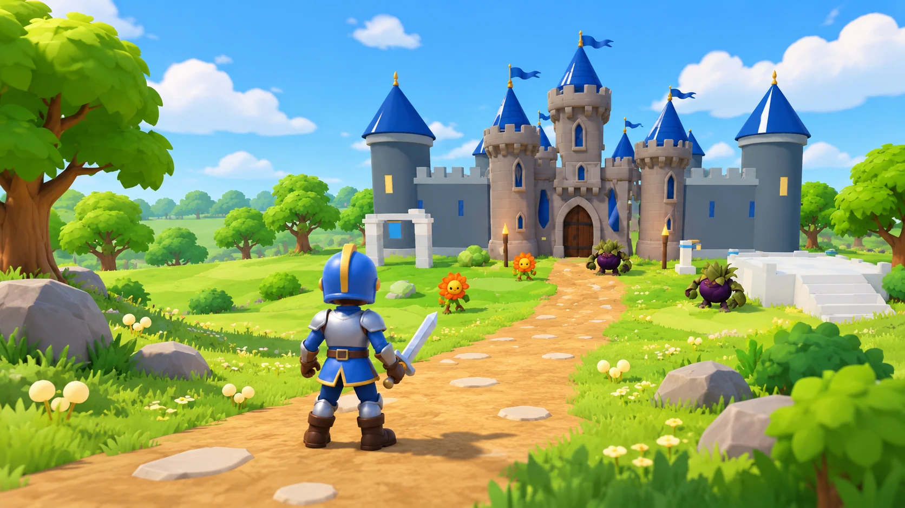
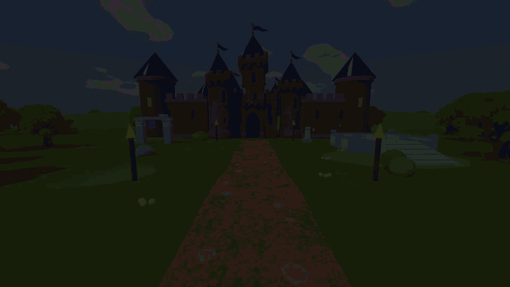
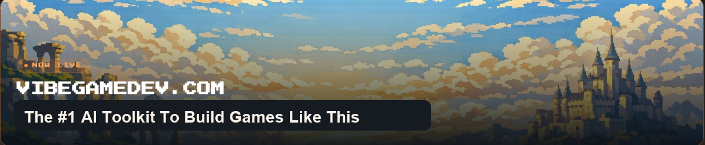

<div align="center">



# Bramblekeep

### Storm the castle that grows back.

A persistent, multiplayer castle-assault game for the browser, written from short prompts by
**GPT 6.1 Terra** in Codex. This is the complete source, every prompt and the lessons.

<br>

[](https://www.vibegamedev.com/?utm_source=github&utm_medium=readme_badge&utm_campaign=bramblekeep)

[**▶ Play Bramblekeep**](https://bramblekeep.vercel.app) &nbsp;·&nbsp;
[**Read the lessons**](share/master.html) &nbsp;·&nbsp;
[**Browse the prompts**](prompts/INDEX.md) &nbsp;·&nbsp;
[**Learn to build games like this**](https://www.vibegamedev.com/?utm_source=github&utm_medium=readme_links&utm_campaign=bramblekeep)


<br>



</div>

---

## The game

You pick a hero, cross the river and take the castle. The gate is held shut by two levers: break both and it
crashes down while you keep fighting. Inside the courtyard a heart tree pulls itself out of the ground and
becomes the **Bramble Boss**, which marks the ground where it is about to strike. When it falls the castle
grows back and a new round starts for everyone.

- **Three heroes.** Knight, Spellcaster and Scout, each with their own moves, weapons and way of fighting.
- **A world that stays up.** One shared castle, a 20-minute day and night that keeps running with nobody in it, and
  up to 24 players dropping in and out. If you play alone, the server fills the party with AI teammates.
- **Built to run on a phone.** Portrait layout, touch controls, and a menu that is the live world.
- **No off-the-shelf engine.** A fixed-step simulation in Rust compiled to WebAssembly, and a renderer that talks to
  WebGPU directly with a WebGL 2 fallback, with no Three.js. Online, an authoritative Colyseus server owns the
  world and the client predicts its own movement.

## Run it

You need Node.js 22.4+, Rust (the pinned toolchain adds the `wasm32-unknown-unknown` target on first build) and a
recent Chrome.

```sh
npm ci
npm run dev                  # the game at http://localhost:5173
npm run play                 # the shared world server plus the client, for multiplayer
npm test                     # Rust tests
npm run test:game            # TypeScript tests against the built simulation
npm run smoke                # the packaged build in headless Chrome
```

The models, audio and UI art the game ships are in [`game/public/assets`](game/public/assets). The Blender
sources they were built from are not in this repository, only the scripts that rebuilt and checked them
([`game/art`](game/art)).

## What's here

| Path | What it is |
| --- | --- |
| [`game/`](game) | Bramblekeep itself: the TypeScript game (`src/`), its Rust simulation (`crate/`), the multiplayer world server (`server/`), runtime assets (`public/`), design docs (`docs/`) and its tests |
| [`src/`](src), [`crates/engine/`](crates/engine) | The game-neutral engine: renderer, glTF loading, audio, input, menus, platform adapters. It reaches the game only through the `@game` alias |
| [`prompts/`](prompts) | Every prompt sent while building the game, verbatim, one file per step |
| [`plans/`](plans), [`learnings/`](learnings) | The plan each step followed and what it taught, cross-linked to its prompts |
| [`share/master.html`](share/master.html) | The lessons: fifteen short slide decks, from finding the game to the trailer, with the clips and screenshots from the build. Open it in a browser and use the arrow keys |
| [`docs/direction/`](docs/direction) | The premise and the four directions explored before one was chosen, with the mockups |
| [`tests/`](tests), [`scripts/`](scripts), [`deploy/`](deploy) | Engine tests, build and packaging scripts, and the release rules |

## Read it in this order

1. [`share/master.html`](share/master.html): the lessons, with a deck for each stage of the build
2. [`prompts/INDEX.md`](prompts/INDEX.md): the prompts behind them, from the first premise to the guardian release
3. [`docs/direction/`](docs/direction) and [`game/docs/`](game/docs): the four directions the game was chosen from, then the contracts and floor plans the agent worked from
4. [`game/server/README.md`](game/server/README.md): how the shared world, reconnects and AI teammates work

<div align="center">

<br>

## Build games like this with AI

This repository is one project. **VibeGameDev** teaches the whole method: how to direct a coding agent through
mockups, models, animation, multiplayer and launch, with the project templates, skills and source of games like
this one.

[](https://www.vibegamedev.com/?utm_source=github&utm_medium=readme_footer&utm_campaign=bramblekeep)

**[vibegamedev.com](https://www.vibegamedev.com/?utm_source=github&utm_medium=readme_footer&utm_campaign=bramblekeep)**

<br>

Made by **Chong-U** &nbsp;·&nbsp;
[𝕏 @chongdashu](https://x.com/chongdashu) &nbsp;·&nbsp;
[YouTube @AIOriented](https://youtube.com/@AIOriented) &nbsp;·&nbsp;
[GitHub @chongdashu](https://github.com/chongdashu)

<sub>Brought to you by [vibegamedev.com](https://www.vibegamedev.com/?utm_source=github&utm_medium=readme_footer&utm_campaign=bramblekeep)</sub>

</div>

## Licence

Source code: [MIT](LICENSE). Lessons, prompts, models, audio and art: [CC BY-NC 4.0](CONTENT-LICENSE.md).

