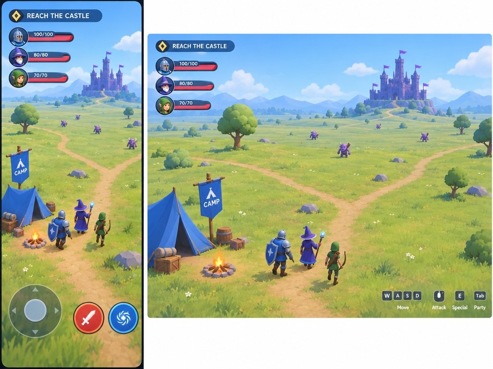
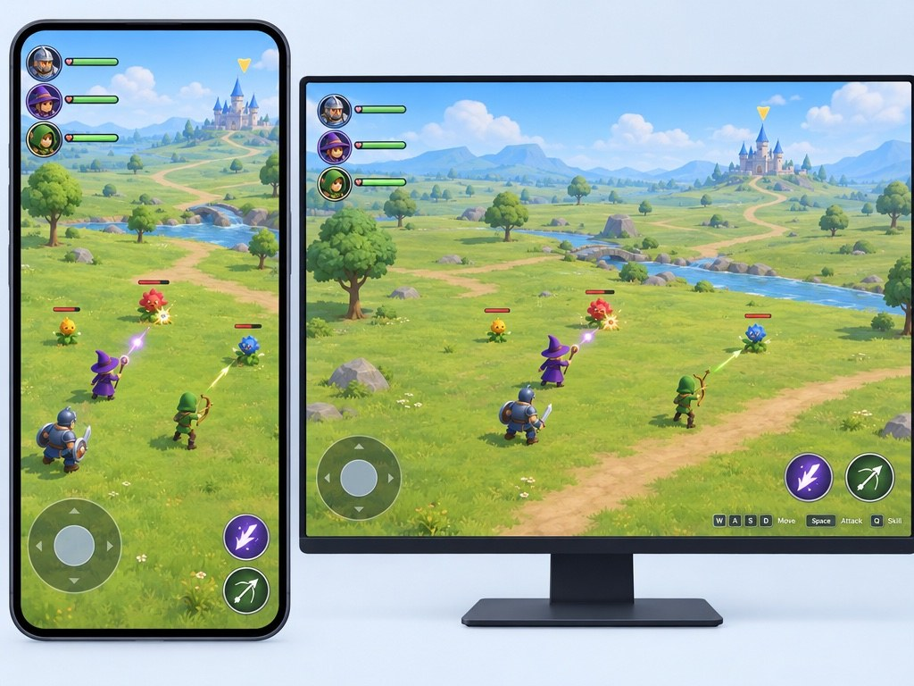
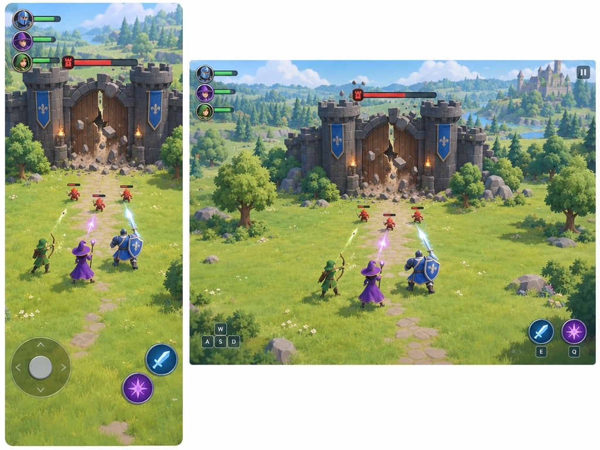
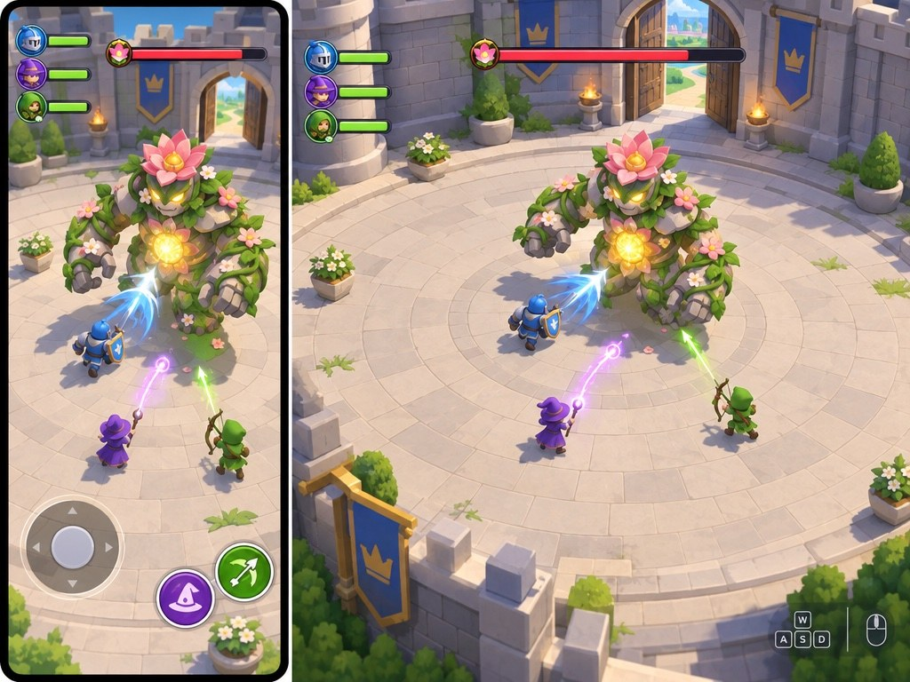

# Review 1 follow-up — from camp to castle

The user changed the premise: players start at a camp, travel through a larger world and fight minions; defeating them brings down the enemy castle's gate, allowing players to enter and defeat the boss or core. These four mockups show **moments in the same proposed loop**, rather than competing settings. They are generated concepts, not gameplay captures.

## A — Camp

Players begin at a friendly camp and set out toward the distant castle. The open terrain is easy to read; the castle is tiny on a phone, and the shallow camera and sparse world are only illustrative.

## B — Explore and fight

Players roam an open landscape and fight minions. Branching paths and the clear spacing suggest room to explore, but a still cannot establish actual traversal; the desktop image incorrectly shows a touch joystick.

## C — Breach the gate

Players clear minions on the way to the gate. The castle and combat targets are readable, but the gate is already breaking while minions remain; the intended sequence—defeat minions, then the gate breaks—needs to be communicated in motion.

## D — Boss and core

Players face a large garden creature inside the castle. The boss and attacks are clear; the glowing core on its body is a visual proposal, not a decision about whether the boss and core are one entity.

| Moment | What reads well | Biggest risk | Asset feasibility |
| --- | --- | --- | --- |
| Camp | Recognizable starting place and distant destination. | Empty terrain could make the trip feel uneventful. | Simple camp and terrain are feasible; the explorable area needs content. |
| Explore | Clear space and enemy targets. | The camera and movement through a large world need portrait testing. | Modular terrain and a few creatures are feasible; broad content is a longer-term task. |
| Gate | Players visibly fight toward an enemy stronghold. | The gate's opening condition is not clear in a still. | Modular gate and a staged break are feasible; shared progress requires multiplayer design. |
| Boss | Distinct boss, clean arena and legible attack targets. | Silhouette and effects must remain readable on mobile. | A stylized boss and arena are feasible; animation and networked combat need validation. |

All use fal GPT Image 2.5 Flare. [Exact prompts and receipts](../../share/media/20261027-castle-assault/) are saved alongside the images. This round cost **$0.1507**. One previously queued defensive-castle image completed after the change of premise and cost **$0.0439**; three other planned requests were stopped before submission. Total fal spending is **$0.6755 of $10**.

**My pick:** Treat A–D as a sequence, keeping B's open exploration and D's clear combat; develop the gate-opening rule next.

## Decision

On 2026-10-27, the user chose a mixture of **B and C**: the open exploration and combat of B with C’s castle and gate approach. The boss/core relationship remains open.
