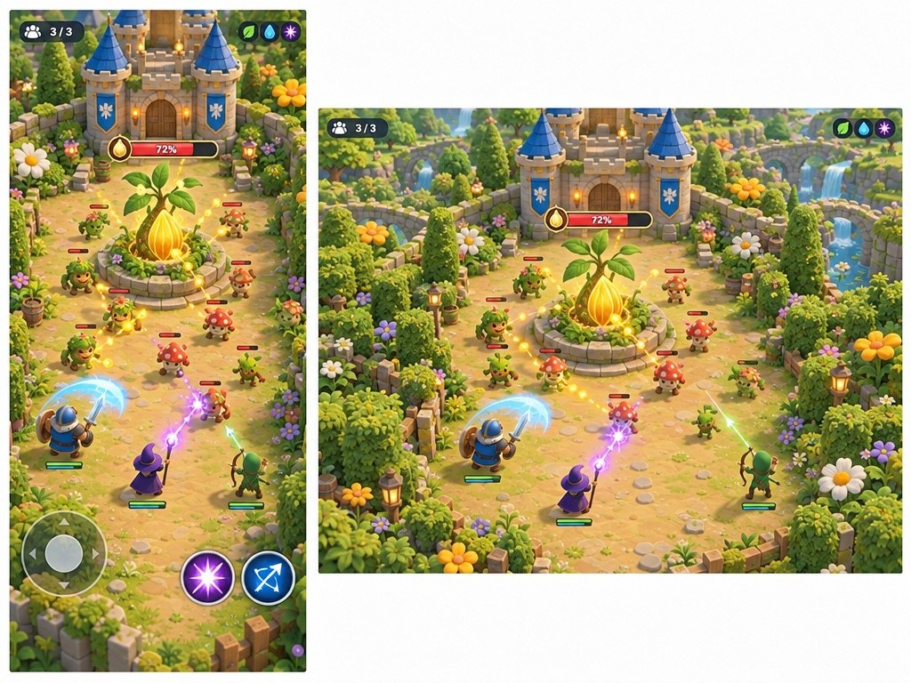
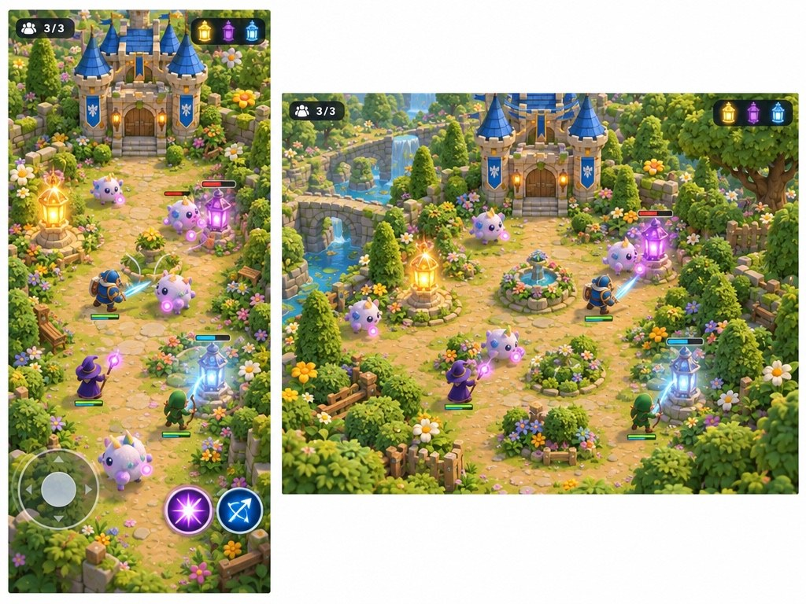
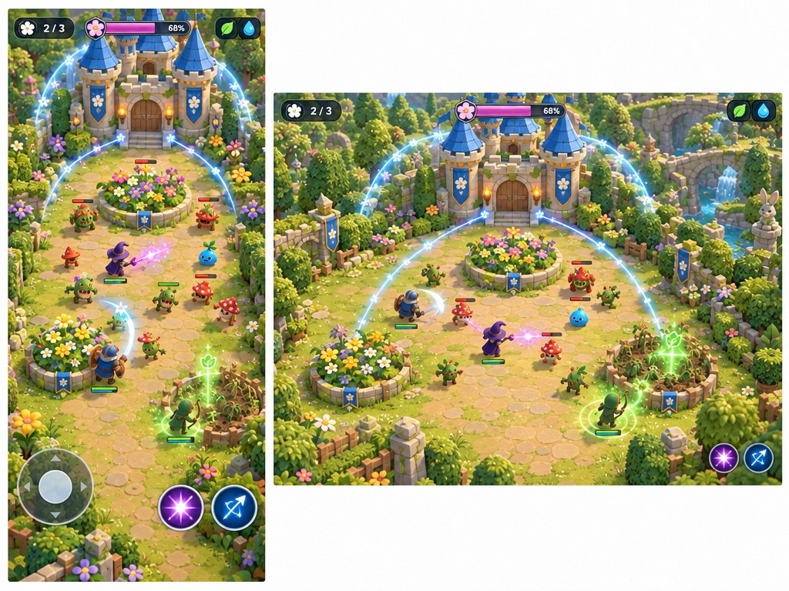
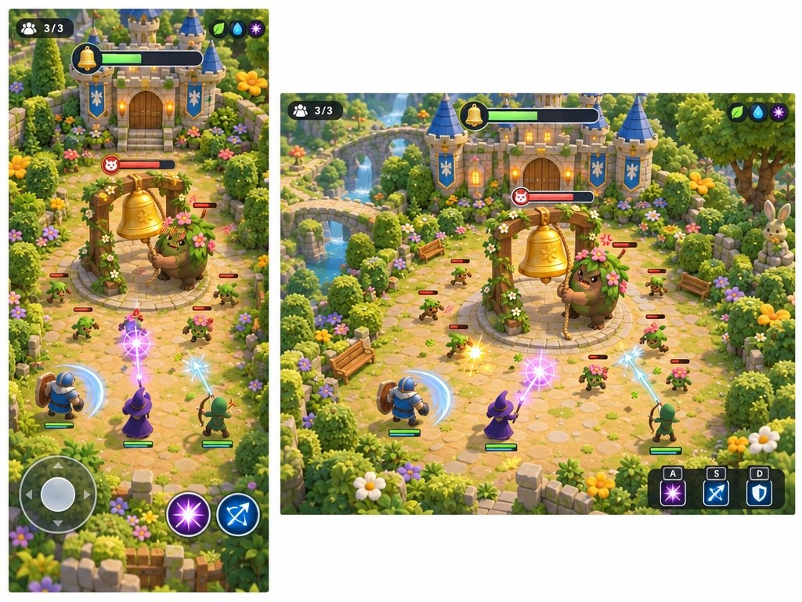

# Garden castle — gameplay directions

**Update, 2026-10-27:** The user wants enemies attacking the castle itself and a more expansive game. The concepts below are earlier explorations, not the chosen main objective.

The chosen garden castle is a persistent shared place. These are **design proposals**, not settled mechanics. Each gives creatures a visible reason to approach the castle and defenders a clear thing to protect.

## A. Heartseed — defend one living heart

A magical seed grows at the center of the castle garden. It sustains the castle and its strange, friendly inhabitants. Curious light-hungry creatures gather around it and try to drain its glow. Defenders intercept them, use class attacks together and help the seed recover when an attack ends.

- **What reads well:** one obvious objective and a single health-like meter; easy for a new player to understand.
- **Gameplay consequence:** players converge in the same place, so cooperation is natural, but the action may become static unless threats approach from different routes.
- **Failure proposal:** the seed goes dormant and the garden temporarily wilts; it can recover, rather than deleting the persistent world.

## B. Dream lanterns — protect the sleeping castle

The castle is dreaming, and three lanterns hold its dreams safely. Mischievous dream-eaters try to snuff the lanterns. Defenders move between threatened lanterns, drive creatures off and rekindle them after danger passes.

- **What reads well:** glowing targets and creatures visibly moving toward them make priorities clear.
- **Gameplay consequence:** several simultaneous targets encourage players to split up and regroup, but can overwhelm a lone defender.
- **Failure proposal:** if all lanterns go out, the castle has a short nightmare and the garden resets to a peaceful state.

## C. Flower beds — tend a living defense

Flower beds feed the castle's protective bloom. Hungry creatures nibble them, weakening that protection. Defenders fight creatures and help damaged flowers grow back in calm moments.

- **What reads well:** flowers can visibly wilt, making damage and recovery tangible without relying only on numbers.
- **Gameplay consequence:** players have a gentle activity during quiet periods and a reason to move around; maintenance must feel rewarding rather than like chores.
- **Failure proposal:** the bloom fades and the garden rests before growing back; a setback never permanently erases the world.

## D. The bell — keep the castle asleep

A great bell sits in the garden courtyard. Playful creatures want to ring it and wake the sleeping castle. Guardians fend them off as they approach and pull its rope; between incidents the bell gradually settles.

- **What reads well:** creatures touching the bell or rope communicate the threat directly, and a rising alarm meter shows urgency.
- **Gameplay consequence:** a central target supports quick drop-in action; the bell needs enough changing threats to avoid feeling repetitive.
- **Failure proposal:** a ring wakes the castle briefly, triggering a playful shared event before calm returns.

The images are concepts, not runtime captures. Creature interactions are ambiguous in A–C; D shows a creature pulling the bell rope. Several portrait views still suggest a narrow lane, so the arena layout needs separate exploration. All four were edits of the selected garden reference with fal GPT Image 2.5 Flare; [prompts and receipts](../../share/media/20261027-garden-gameplay/) are saved alongside the images. This round cost $0.1748; cumulative fal spend is $0.3055 of $10.

## Shared rules to test

- **One player:** a safe, calm baseline, with occasional manageable encounters or optional activity. No player should be punished for simply being alone.
- **More players:** add threats gradually based on active defenders, their locations and the current state. Telegraph changes; ease pressure when people leave. Do not spawn a full group challenge instantly on a join.
- **Nobody present:** the persistent world rests in a safe state; no unattended destruction. The actual server sleep and persistence model is still an implementation decision.
- **Drop in or out:** show the current objective and threat on arrival. Departures cannot strand remaining players in an impossible encounter; joining does not require waiting for a round.
- **Classes:** give each a distinct silhouette, basic attack and special. Exact abilities and controls need playtesting on portrait screens.
- **Setback:** use a readable shared consequence and a path back to equilibrium; do not silently reset, require continuous attendance or erase the world.

**Recommendation:** start with **A, Heartseed**, and borrow C's small flower-recovery moments. One objective keeps the first multiplayer slice understandable, while the garden offers an optional quiet activity. Keep the exact failure and recovery flow open until a playable test.

## Decision

The user redirected the main objective to defending the castle itself and asked for a more expansive game. The details remain open.
