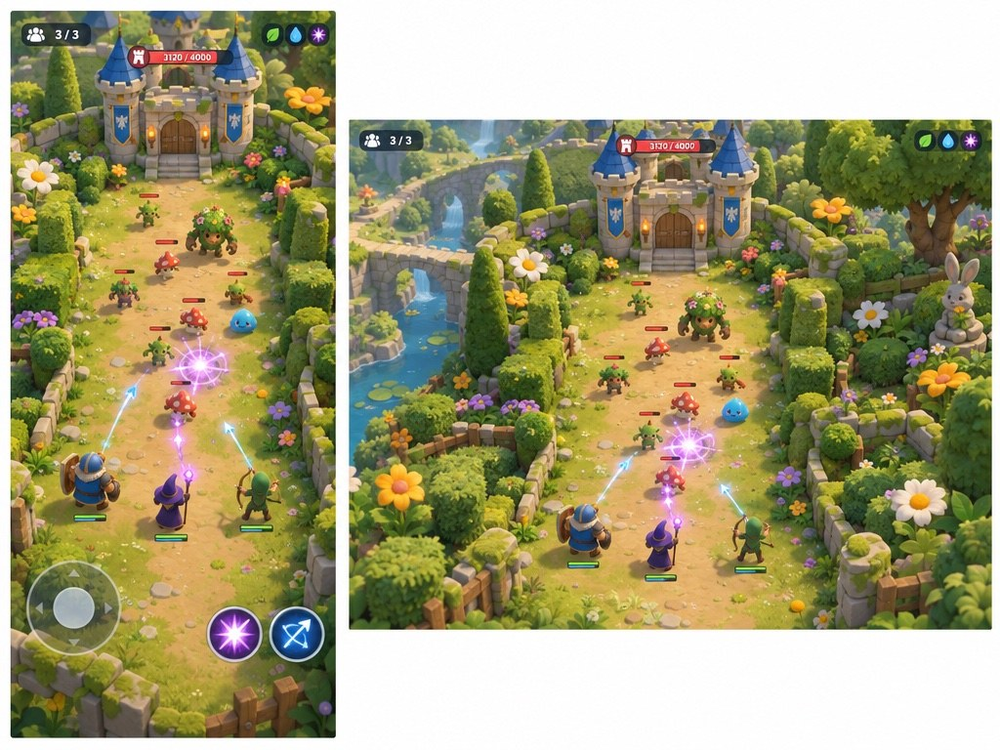
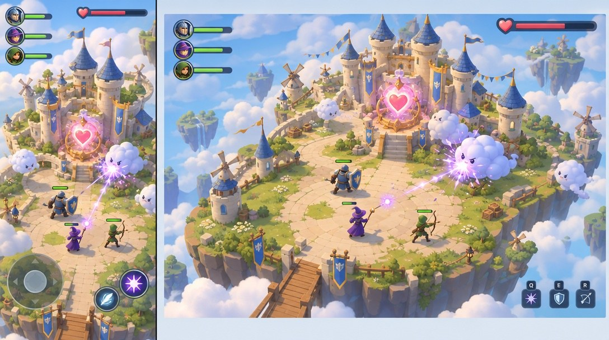
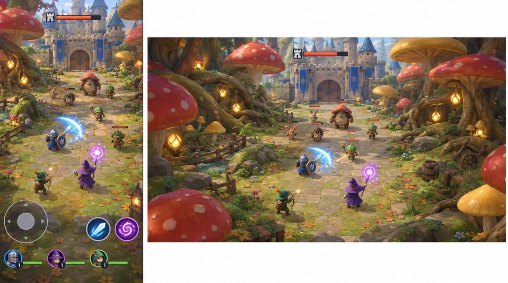
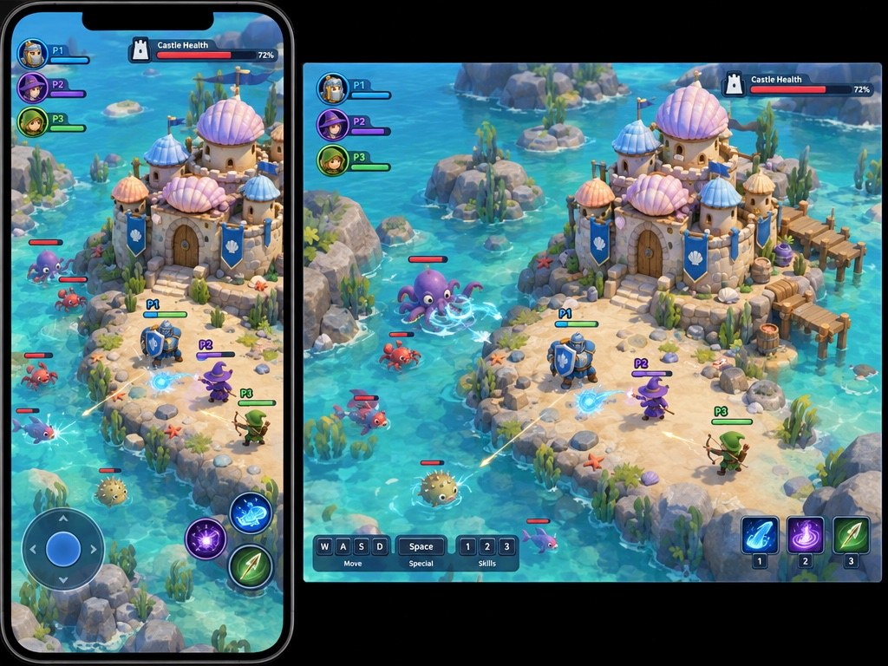

# Review 1 — castle defense directions

Four generated gameplay concepts explore different settings with the same angled camera, class-based defense and paired portrait/desktop views. These are visual proposals, not gameplay captures. Layouts, enemy variety and asset detail will need to be tested in the actual game.

## A — Garden of the Sleeping Keep

## B — Castle Above the Clouds

## C — The Mushroom Court

## D — The Tidepool Citadel

| Direction | What the player does | What reads well | Biggest risk | Can our asset tools reach it? |
| --- | --- | --- | --- | --- |
| A — Garden | Defend the keep from lively plants and creatures with teammates. | Bright castle, clear defenders and contrasting enemies. | Dense foliage and the narrow approach could suggest a fixed lane instead of a persistent open arena. | Yes, with simplified modular foliage and stone; the image is more detailed than the first slice. |
| B — Cloud | Protect a floating castle's glowing heart from cloud creatures. | Clear central objective and open arena, with a strong sky silhouette. | Small figures on portrait and similar enemies may make encounters hard to read. | Yes, with simple floating islands and stylized clouds; detailed architecture needs reduction. |
| C — Mushroom | Hold a forest castle against woodland creatures among giant fungi. | Strong sense of place and varied enemy silhouettes. | Dense detail and lower camera angle may obscure mobile gameplay and limit arena visibility. | Yes, with reusable mushrooms and simpler materials; this image's foliage and lighting are ambitious. |
| D — Tidepool | Defend a shell-roofed castle from playful sea creatures. | Distinct sea-creature shapes, class silhouettes and a clear castle health display. | Water effects, many small props and the narrow shoreline may complicate production and movement. | Yes, with modular rocks and shell roofs; water and scene detail need simplification. |

Each [image, exact prompt and cost receipt](../../share/media/20261027-review-1/) is saved together. All four used fal GPT Image 2.5 Flare; their reconciled charges total **$0.1307** against the $10 cumulative cap. The four images differ in prompt details and composition as well as setting, so they are creative comparisons rather than a controlled rendering experiment.

**My pick:** D — its creatures and shell-roofed castle give the world an immediately distinctive identity while keeping defenders readable.

## Decision

Selected **A — Garden of the Sleeping Keep** on 2026-10-27. The user asked to explore the gameplay, including what players defend and what monsters attack, before producing follow-up mockups.

The [larger-world follow-up](world-defense.md) explores enemies attacking the castle itself.
