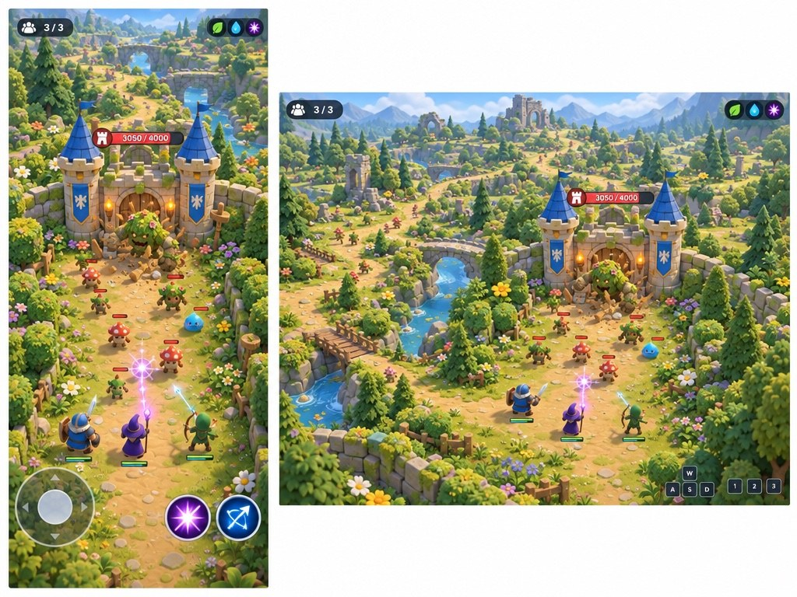
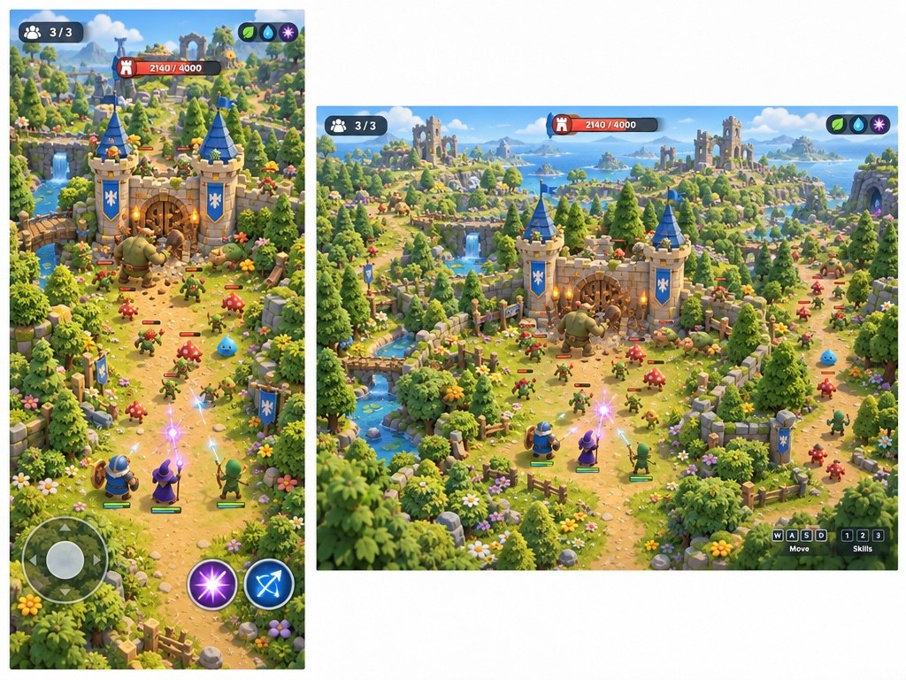
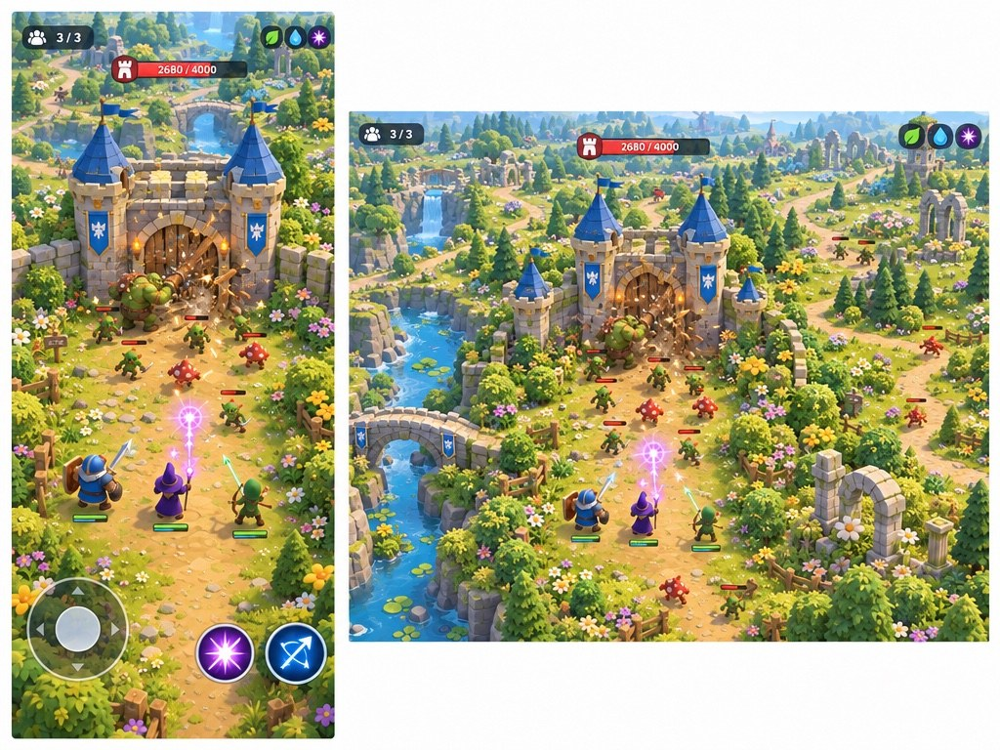
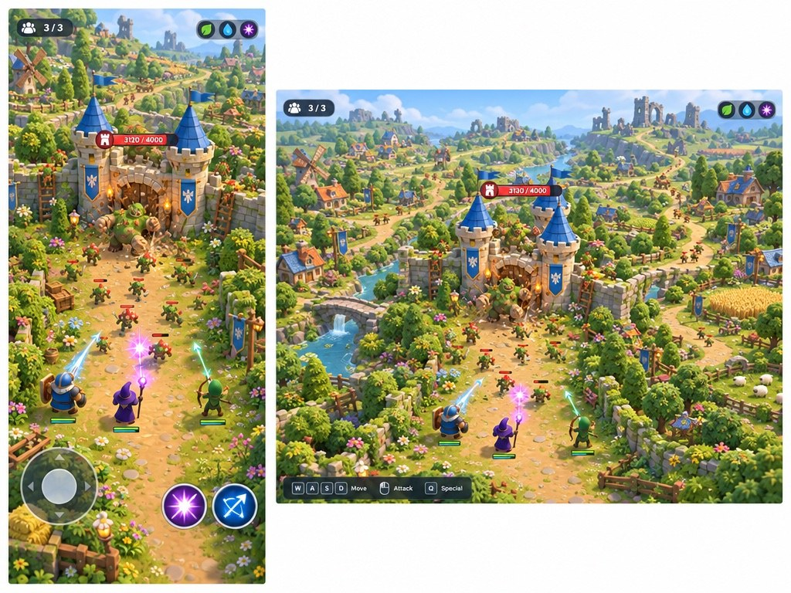

# Earlier Review 1 follow-up — a larger world, a castle to defend

**Superseded:** the user changed the premise to players assaulting an enemy castle. See [the camp-to-castle sequence](castle-assault.md).

Four concepts retain the selected garden castle style and show enemies attacking the castle gate. Each pairs portrait and desktop views. These are generated concepts, not gameplay captures: distant scenery does not prove it is traversable, and all four phone views still read as a narrow combat lane. A future layout study must show how players actually leave the castle and move through the world.

## A — Open valley

## B — Woodland frontier

## C — River and ruins

## D — Rolling hills and villages

| Option | What players do | What reads well | Biggest risk | Asset feasibility |
| --- | --- | --- | --- | --- |
| A — Valley | Fight off an enemy battering the gate, then follow branching valley paths. | Gate attack, classes and the valley's layered paths. | Phone view suggests a single lane; distant world may feel like backdrop. | Modular walls, vegetation and ruins are feasible; generated detail needs simplification. |
| B — Woodland | Defend the gate and venture along forest routes and clearings. | Gate threat and wooded landscape give a sense of an occupied frontier. | Dense trees and small figures can obscure navigation and combat on a phone. | Reusable trees and paths are feasible; scale and foliage need performance tuning. |
| C — River | Protect the castle and explore bridges, riverbanks and old ruins. | Visible gate damage and landmarks give the world navigational identity. | Crossings could funnel movement; water and distance detail add production cost. | Modular bridges and ruins are feasible; water and detailed scenery need simplification. |
| D — Hills | Defend the gate and wander among fields, villages and hilltop ruins. | The surrounding inhabited landscape suggests a world that continues beyond the fight. | Many small structures may imply an amount of content and traversal not proven by the image. | Modular buildings and terrain are feasible; populated villages are a larger scope. |

The four outputs are close variations because all were edited from the same reference; scenery and framing vary as well as layout. The exact prompts, models and receipts are [alongside the images](../../share/media/20261027-world-defense/). This round's fal charges total **$0.1754**, bringing cumulative spending to **$0.4809 of $10**.

**My pick:** C, for its memorable landmarks and branching paths; keep D's sense of a living world as a longer-term aspiration.

## Decision

Awaiting your choice or combination.
