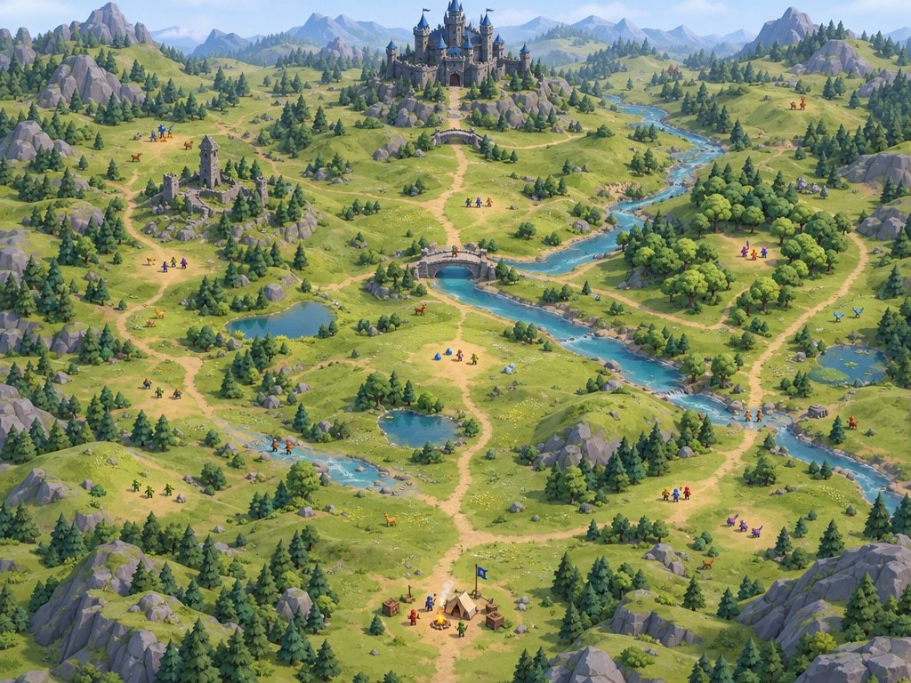
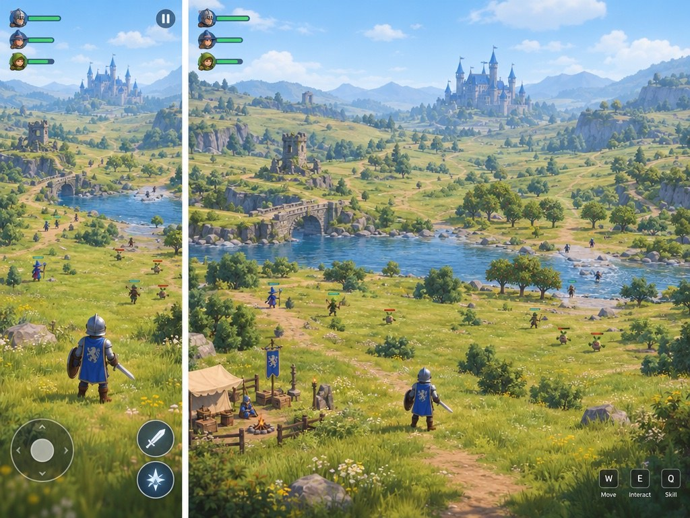
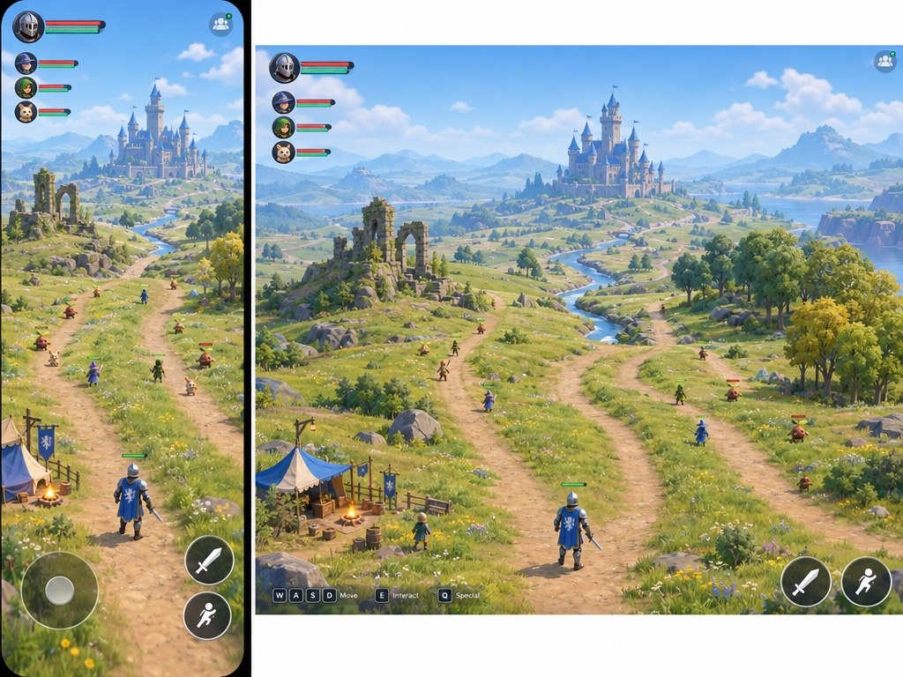
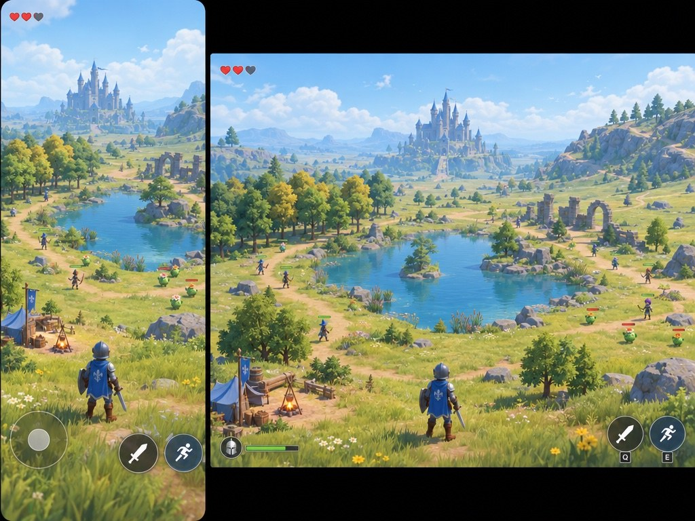
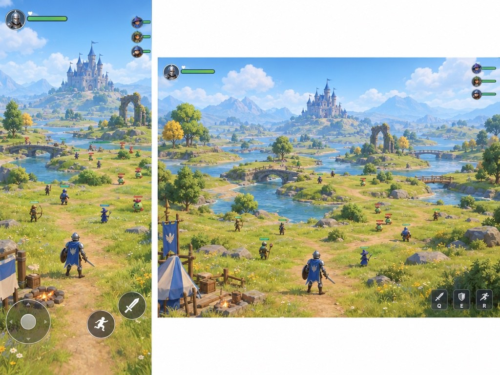

# World-scale study — camp to castle

These are **generated concepts, not game captures**. They explore one visual direction (the selected open exploration of B and enemy castle of C) with four different route arrangements. A second character-facing camera study was not generated: both images in each pair are the same proposed encounter in portrait and desktop. The lower, behind-the-character view is a camera proposal, not yet tested for combat legibility. The generated scenes include richer foliage, terrain and materials than the current runtime can produce and still share a similar palette; the variety here is geographic rather than a new art-style choice.

## Whole-world planning view

The camp is at the bottom, the castle is above, with multiple connected routes, landmark clusters and encounter clearings in between. Markers suggest separated groups; this illustration does **not** prove that the world fits 20–30 people, that paths connect correctly, or that networking supports them. The generator placed more greenery and figures than requested, so it should not be read as a density target. The target is room for groups to split up, regroup and make progress without the scene becoming cluttered.

## A — River valley

Explore a wide valley with a distant castle, riverside ruins and crossings. The river and distant layers convey distance; the castle and many distant characters are tiny on mobile. The broad valley and bridge are feasible modular shapes, while the dense terrain, detailed vegetation and water are beyond the current test scene.

## B — Parallel ridges

Choose between ruin, meadow and grove routes that converge toward the stronghold. The branching reads at a glance, though the river does not clearly provide three complete routes and the desktop mockup wrongly includes touch-style buttons. Low ridges and modular ruins are feasible; layered terrain, grass and precise routes need building and testing.

## C — Open basin

Travel around either shore of a pond, passing a grove or ruins. The body of water makes a clear central landmark, but it occupies much of the frame and could constrain paths or combat. Ponds and simple ruins are feasible; convincing water and broad connected traversal require new work.

## D — River islands

Cross an interconnected river plain toward the castle. The clearings and multiple crossings suggest groups can split and rejoin; crossings could become bottlenecks, especially for a larger player population. Modular bridges and islands are feasible; water, traversal and pathfinding need implementation.

| Option | Player does | What reads well | Main risk | Asset reach |
| --- | --- | --- | --- | --- |
| A | Cross a valley by bridge or ford | Layered distance and a visible destination | Castle and other players become tiny | Basic terrain/bridge feasible; foliage and water exceed the lab |
| B | Follow parallel routes through distinct landmarks | Immediate route choices and visible knight | Routes may converge too early; inaccurate desktop UI | Modular ridges and ruins feasible; terrain and layout require work |
| C | Circle a pond via grove or ruins | Central landmark and two sides | Water consumes combat space | Pond geometry feasible; polished water and route testing remain |
| D | Split and regroup across several crossings | Distributed clearings and connections | Narrow crossings can bottleneck a crowd | Repeated bridges feasible; water and navigation remain |

## Working design interpretation

More props alone will not make the world feel expansive. Depth comes from terrain that overlaps at several distances, a recognizable distant destination, routes that separate and reconnect, and enough broad walkable space between landmarks. Start with a modest reusable set—two tree silhouettes, rocks, a ruined arch or lookout, camp pieces, bridge and ford—then use terrain shape, path placement and distance to create distinct areas. Scale and clearance must be checked with actual character movement, sightlines, encounter design and eventually 20–30 connected clients; the generated picture is not a benchmark.

**Suggested starting point:** B's branching ridges for readable routes, with a bridge and ford from A as a secondary connection; retain C's pond only where it does not shrink combat space. This is a proposal, not a user decision.

## Generation record

Five fal GPT Image 2.5 Flare images cost **$0.1907**, reconciled from request billing headers. [Exact prompts and sanitized receipts](../../share/media/20261027-map-study/) are stored beside the images. The four playable views were produced concurrently within this track because the available agent slots were already assigned to requested character and enemy work. User selection and verification against a runtime camera are still open.

## Decision

Pending user review.
